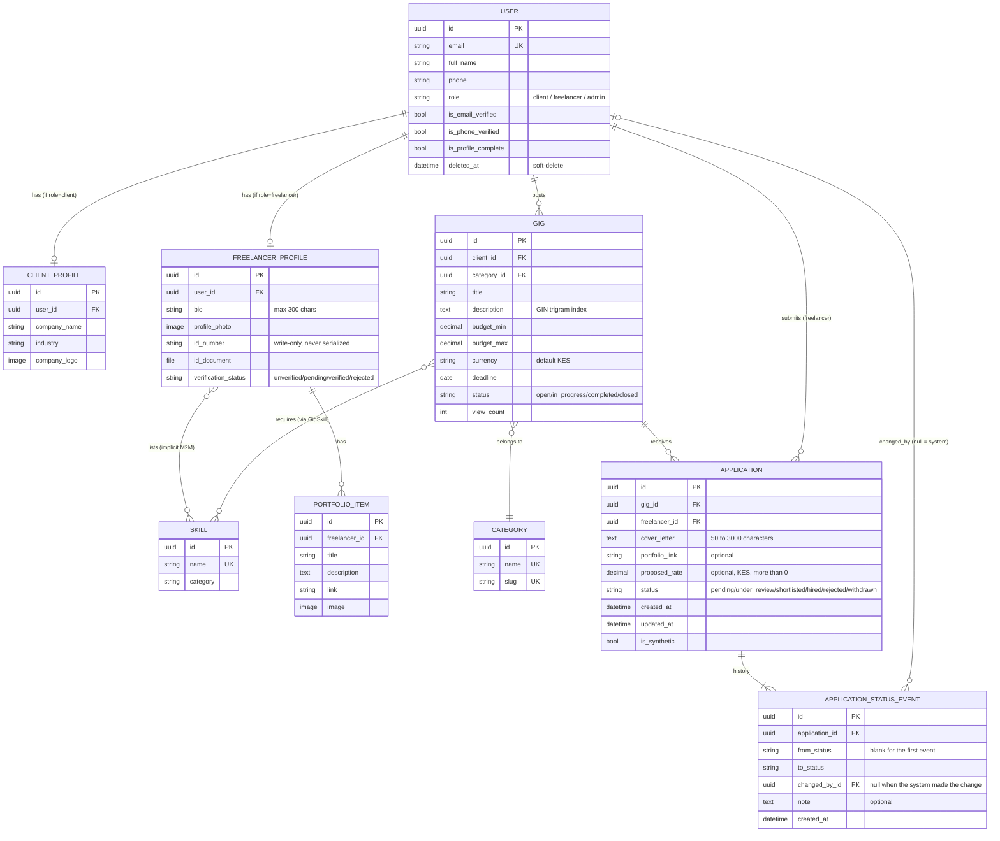

# Entity Relationship Diagram

Core domain entities as of Sprint 4. `NotificationPreference`, `UserSession`, `OTP`, `SkillAlias`
and `GigInteraction` (supporting tables) are omitted from the diagram to keep it readable, and some
columns added since Sprint 2 (such as `county`, `is_remote` and `is_synthetic`) are only listed
where they matter here. See `backend/*/models.py` for the full definitions.

Note: `User` does not have a single `Profile` — the profile is split into `ClientProfile` and
`FreelancerProfile` depending on `role`, each auto-created via a `post_save` signal. `Gig` and
`FreelancerProfile` each have a nullable `county` (one list of counties, served by
`GET /api/meta/counties/`), and `Gig` also has `is_remote`.

## Applications

**Constraints** (enforced by the database, so they hold even if two requests arrive together):

- `unique_application_per_gig`: one application per freelancer per gig. This is also why a
  freelancer who withdraws cannot apply to the same gig again.
- `one_hired_application_per_gig`: at most one `hired` application on a gig.

**Indexes:** `app_freelancer_status_idx` (a freelancer's list, filtered by status) and
`app_gig_status_idx` (a client's applicants list and the My Gigs counts).

**Status rules** live in one module, `backend/applications/transitions.py`, which the API uses and
the frontend reads through `allowed_next_statuses`:

| Who | From | To |
|---|---|---|
| Client | pending | under_review, rejected |
| Client | under_review | shortlisted, rejected |
| Client | shortlisted | hired, rejected |
| Freelancer | pending, under_review | withdrawn |

`hired`, `rejected` and `withdrawn` are final. Every change writes an `ApplicationStatusEvent`.

**When a freelancer deletes their account** (`backend/applications/privacy.py`): their pending,
under review and shortlisted applications are withdrawn with a system event (`changed_by` null),
the cover letter, portfolio link and proposed rate are cleared on all of their applications, and
any reason they typed when withdrawing is cleared from the history. The rows and history stay, so
the client's records and counts still make sense, and a `hired` application stays `hired`. This
is the one place a shortlisted application is withdrawn without going through the normal rules,
because it is a system action and not a choice by the freelancer.
